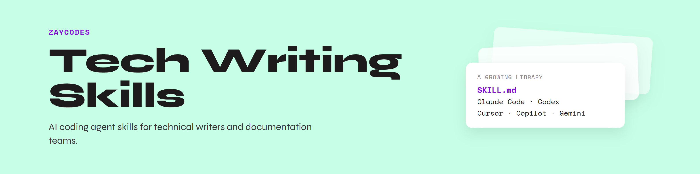

# Tech writing skills

AI coding agent skills for technical writers and documentation teams.

Each skill is a folder with a Markdown file of instructions, `SKILL.md`. Most AI coding agents can read these files, including Claude Code, Codex, GitHub Copilot, Cursor, and Gemini CLI.

## What is in this repo

| Folder | What it is | Guide |
|---|---|---|
| [`ai-docs-pipeline/`](ai-docs-pipeline/) | Five skills that work together to take a documentation ticket through research, planning, drafting, and review | [AI Documentation Pipeline](https://zaycodes.com/resources#ai-doc-pipeline) |

More skills will be added here.

## How to use the skills

1. Open the folder for the skills you want and read its README.
1. Copy the skills into the folder your AI coding agent reads skills from. Each folder's README lists the location for each tool.
1. Restart your agent so it picks up the new skills.

## License

MIT. See [LICENSE](LICENSE).
