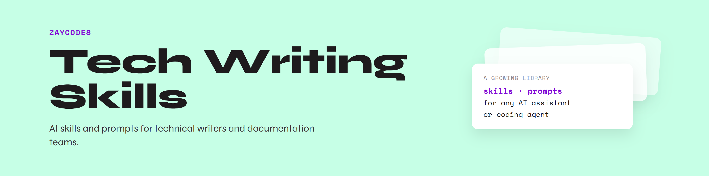

# Tech writing skills

AI skills and prompts for technical writers and documentation teams.

The repo holds two kinds of files.

* **Skills** are folders with a Markdown file of instructions, `SKILL.md`. AI coding agents such as Claude Code, Codex, GitHub Copilot, Cursor, and Gemini CLI run them as commands.
* **Prompts** are Markdown files you copy into any AI assistant, such as ChatGPT, Claude, or Gemini. They need no setup.

## What is in this repo

| Folder | What it is | Guide |
|---|---|---|
| [`ai-docs-playbook/`](ai-docs-playbook/) | Prompts for seven documentation workflows, from briefing an AI assistant to auditing terminology | [AI Docs Playbook](https://zaycodes.com/resources#ai-docs-playbook) |
| [`ai-docs-pipeline/`](ai-docs-pipeline/) | Five skills that work together to take a documentation ticket through research, planning, drafting, and review | [AI Documentation Pipeline](https://zaycodes.com/resources#ai-doc-pipeline) |

More will be added here.

## How to use them

1. Open the folder you want and read its README.
1. For prompts, copy the prompt into your AI assistant and fill in the placeholders.
1. For skills, copy them into the folder your AI coding agent reads skills from, then restart the agent. The folder's README lists the location for each tool.

## License

MIT. See [LICENSE](LICENSE).
