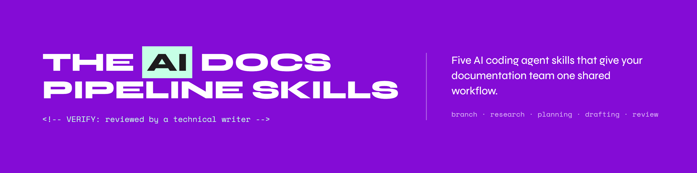

# AI documentation pipeline skills

This folder contains the five skills from the [AI Documentation Pipeline guide](https://zaycodes.com/resources#ai-doc-pipeline).
Copy them into your documentation repository and run them in order on a ticket.

Read the guide first. It explains how the stages connect and what you review at each one.

## What is in this folder

| Path | What it is |
|---|---|
| `skills/branch/` | Stage 0. Creates a feature branch named after the ticket |
| `skills/discover-feature/` | Stage 1. Researches the ticket and writes a research brief |
| `skills/plan-doc/` | Stage 2. Turns the brief into an outline for you to approve |
| `skills/draft-doc/` | Stage 3. Writes the draft, marking gaps and unverified content |
| `skills/doc-review/` | Stage 4. Lints, reviews, and runs a cold-reader check |
| `skills/doc-review/scripts/lint.py` | The mechanical lint script the review runs first |
| `templates/AGENTS.md` | A blank project instruction file. Copy it to the root of your repository and fill it in |
| `templates/skill.md` | A blank skill for writing your own |

Each skill is a folder with a Markdown file of instructions, `SKILL.md`. Most AI coding agents can read these files, including Claude Code, Codex, GitHub Copilot, Cursor, and Gemini CLI. You only need to copy them into the folder your agent uses, listed in the table below.

## Install

1. Copy the five folders inside `skills/` into the folder your AI coding agent reads skills from.

   | Tool | Copy the skills into |
   |---|---|
   | Claude Code | `.claude/skills/` |
   | Codex, Gemini CLI | `.agents/skills/` |
   | GitHub Copilot | `.github/skills/` or `.agents/skills/` |
   | Cursor | `.cursor/skills/` |

1. Restart your agent so it picks up the new skills.
1. Check that the five skills appear, for example by typing `/` in Claude Code.

## Configure before your first run

1. Copy `templates/AGENTS.md` to the root of your repository and fill it in. In its third section, "Repository structure", list the folder your documentation lives in, for example `docs/` for a Docusaurus site. When `plan-doc` adds a new page, it puts it in that folder.
   Claude Code reads `AGENTS.md` when the repository has no `CLAUDE.md`. If you already have a `CLAUDE.md`, add the line `@AGENTS.md` to it.
1. Fill in the CONFIG section at the top of `skills/doc-review/scripts/lint.py` with your team's style rules.
1. Add this line to `.gitignore` at the root of your repository.

   ```
   .doc-workspace/
   ```

   The skills save their working files, such as the research brief and the plan, in `.doc-workspace/`. Ignoring the folder keeps those files on your computer and out of every commit, so they never reach your main branch.

## Connect your tracker

`discover-feature` and `branch` need the ticket. Choose how they get it.

| Option | Setup | What the agent can read |
|---|---|---|
| An MCP server for your tracker, such as Jira, Linear, or GitHub Issues | Add it to your agent once, with an API token or sign-in | The ticket, comments, linked tickets, and linked pages |
| A command-line tool, such as `gh issue view` | Install it and sign in once | The ticket and comments |
| Paste the ticket into the chat, or give the path to a file | None | Only what you give it |

Pasting works with no setup, so start there if you are trying the skills out. The more the agent can read, such as linked tickets and specifications, the fewer open questions the research brief has.

## Run it

Run the skills in order on one ticket. Replace `DOC-1234` with your own ticket ID.

```
/branch DOC-1234
/discover-feature DOC-1234
/plan-doc DOC-1234
/draft-doc DOC-1234
/doc-review DOC-1234
```

Each stage saves its output to `.doc-workspace/DOC-1234/` and stops for you to review before the next one. The first skill creates the folder.

If your agent does not use slash commands, ask it to run the skill instead, for example "Run the discover-feature skill on DOC-1234."

### Run one skill on its own

You do not need all five skills for every change. Each skill also works on its own.

| Skill | Without the earlier skills |
|---|---|
| `branch` | Needs only the ticket ID |
| `discover-feature` | Needs only the ticket |
| `plan-doc` | Tells you there is no research brief, then plans from the ticket and notes you give it |
| `draft-doc` | Tells you there is no plan or brief, then drafts from an outline and sources you give it |
| `doc-review` | Pass a file path instead of a ticket ID, for example `/doc-review docs/path/to/page.md` |

When `plan-doc` or `draft-doc` runs without the earlier files, it says so in its output, so anyone reviewing later can see the research step was skipped. For a small fix, such as a typo, `doc-review` on its own is usually enough.

## License

MIT. See [LICENSE](../LICENSE).
